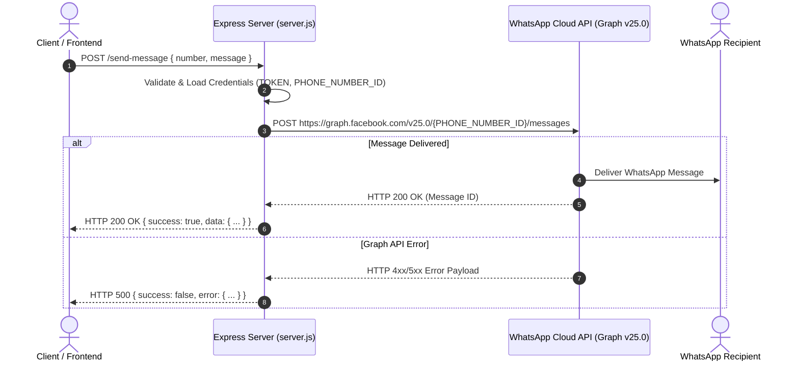

# WhatsApp Cloud API Server

A lightweight Node.js & Express microservice for sending WhatsApp messages via Meta's WhatsApp Cloud API (Graph API v25.0).

---

## 📌 Features

- **Express.js REST API**: Clean HTTP endpoints for sending messages and health checks.
- **Direct Meta Graph API Integration**: Communicates directly with Meta's official WhatsApp Business Cloud API (`v25.0`).
- **Environment-based Configuration**: Easily configure tokens and phone number IDs using `.env`.
- **CORS Enabled**: Cross-Origin Resource Sharing enabled for web client access.
- **Clear Error Reporting**: Captures and relays Facebook Graph API errors back to the caller in standardized JSON format.

---

## 🏗️ Architecture



---

## ⚙️ Prerequisites

- **Node.js**: v18.0.0 or higher
- **npm**: v9.0.0 or higher
- **Meta for Developers Account**: With a registered WhatsApp Business App, Phone Number ID, and Access Token.

---

## 🚀 Getting Started

### 1. Install Dependencies

```bash
npm install
```

### 2. Configure Environment Variables

Create a `.env` file in this directory based on `.env.example`:

```bash
cp .env.example .env
```

Update `.env` with your actual Meta credentials:

```env
TOKEN=your_meta_system_user_or_temporary_access_token
PHONE_NUMBER_ID=your_whatsapp_phone_number_id
PORT=3000
```

### 3. Start the Server

```bash
npm start
```

Default listening address: `http://localhost:3000`

---

## 📡 API Endpoints

### 1. Health Check

Verifies that the server is online.

- **URL**: `/`
- **Method**: `GET`
- **Response**:
  ```text
  WhatsApp Cloud API Server Running 🚀
  ```

---

### 2. Send Message

Sends a plain text message to a specified WhatsApp phone number.

- **URL**: `/send-message`
- **Method**: `POST`
- **Headers**:
  ```http
  Content-Type: application/json
  ```
- **Request Body**:
  ```json
  {
    "number": "919876543210",
    "message": "Hello from WhatsApp Cloud API!"
  }
  ```

#### Example cURL Request

```bash
curl -X POST http://localhost:3000/send-message \
  -H "Content-Type: application/json" \
  -d "{\"number\": \"919876543210\", \"message\": \"Hello from WhatsApp Cloud API!\"}"
```

#### Success Response (`200 OK`)

```json
{
  "success": true,
  "data": {
    "messaging_product": "whatsapp",
    "contacts": [
      {
        "input": "919876543210",
        "wa_id": "919876543210"
      }
    ],
    "messages": [
      {
        "id": "wamid.HBgMOTE5ODc2NTQzMjEwFQIAERgSQ0ZBRDU2OTk0RkVFOTAzRDkyAA=="
      }
    ]
  }
}
```

#### Error Response (`500 Internal Server Error`)

```json
{
  "success": false,
  "error": {
    "error": {
      "message": "Authentication Error",
      "code": 190,
      "type": "OAuthException",
      "fbtrace_id": "A5uoLgm4o_rw6Q5C57h6tEG"
    }
  }
}
```

---

## 🧪 Testing

A test script is included to test the API endpoint:

```bash
npm test
```

This sends a test payload to `http://localhost:3000/send-message` and logs the resulting payload into `api_response.json`.

---

## 📂 Project Structure

```
whatsapp-cloud-api/
├── .env.example         # Template for environment configuration
├── architecture.md      # Detailed system architecture document
├── architecture.mmd     # Raw Mermaid diagram definition
├── package.json         # NPM package manifest
├── package-lock.json    # Exact dependency lockfile
├── server.js            # Express server & route definitions
├── test_api.js          # API test runner script
└── api_response.json    # Sample API response from test runs
```
