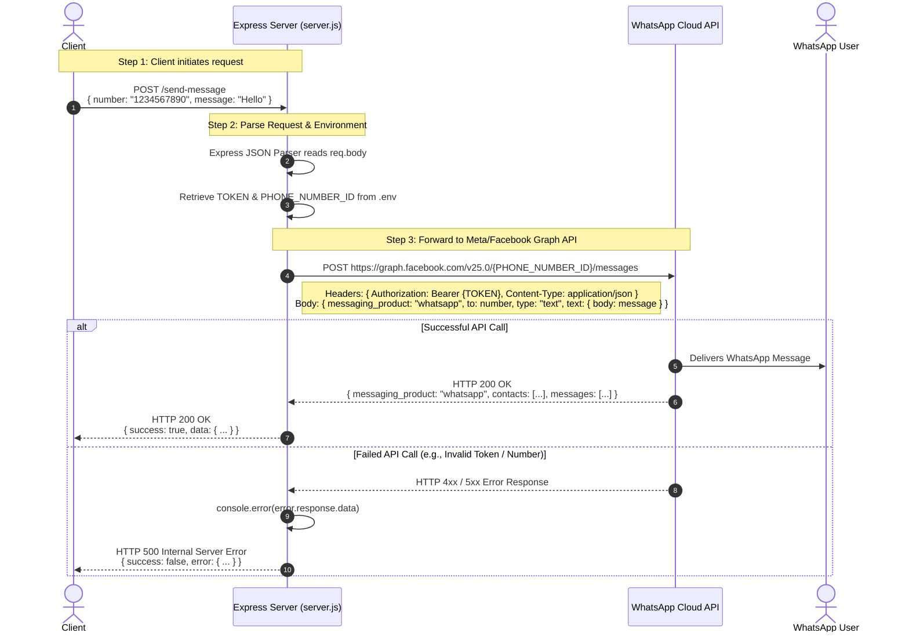

# WhatsApp Cloud API Server Architecture

This document describes the inner workings and architecture of the simple Express-based WhatsApp Cloud API server.

## System Flow (Mermaid Diagram)

The following sequence diagram outlines the entire lifecycle of a `/send-message` request, from the moment a client invokes the API to the point where the WhatsApp Cloud API delivers the message to the end-user.

## Component Breakdown

1. **Client (or `test_api.js`)**: 
   - Triggers a standard HTTP POST request to the local Express server (`localhost:3000/send-message`).
   - Sends a JSON payload containing the `number` (recipient) and `message` (content).

2. **Express Server (`server.js`)**: 
   - Handles the incoming HTTP request.
   - Extracts payload parameters (`number`, `message`).
   - Retrieves the required `TOKEN` and `PHONE_NUMBER_ID` injected via `.env`.
   - Uses `axios` to construct and fire an outbound API request to Facebook's Graph API.

3. **WhatsApp Cloud API (Graph API v25.0)**:
   - Receives the request with the Bearer token authorization.
   - Validates the token and request format.
   - Routes the message to the respective WhatsApp user if valid.
   - Responds to the Express Server with a Message ID on success or an Error object on failure.

4. **Response Handling**:
   - The Express Server returns a simplified `200` status with `success: true` to the Client upon receiving a successful acknowledgement from Facebook.
   - If an error occurs (e.g., Axios throws an exception for 4xx/5xx responses), the Express server's catch block relays a `500` internal server error along with the exact Facebook error payload to the Client.
